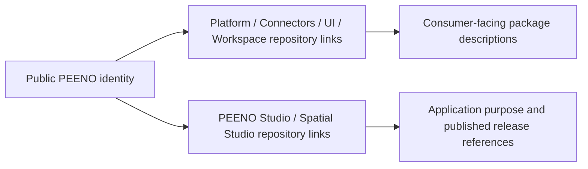

# Public Organization Implementation

Canonical requirements: [PRD](https://github.com/peeno-dev/.github-private/blob/main/PRD.md). Repository contract: [implementation specification](https://github.com/peeno-dev/.github-private/blob/main/IMPLEMENTATION.md#public-organization). Delivery evidence: [STATUS.md](STATUS.md).

**Repository:** `.github`. **Purpose:** Publish accurate public ecosystem/application identity and discoverable repository navigation.

```text
.github/
  README.md
  IMPLEMENTATION.md
  STATUS.md
```



README provides public purpose/repository links. IMPLEMENTATION records ownership of public descriptions, publication/link validation and how verified capability claims are sourced. STATUS records current public-document/link verification and any pending public release-description update. Public descriptions use published/verified capability evidence supplied by owners.

**Implementation evidence:** public repository names/links and product purpose agree with their owning READMEs/releases. Public organization documentation stays focused on public identity and consumer navigation.
